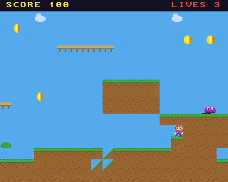
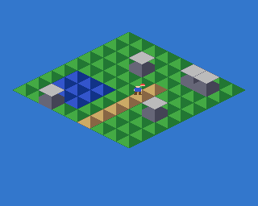

# Fragua

A library for making games in [Dash](https://github.com/FreeMEM/dash) on the Amiga. It comes in two layers:

- **Layer 1, loose pieces, as in pygame:** a double-buffered screen, images, rectangles, a clock, input, sprites
  and groups.
- **Layer 2, nodes and scenes, as in Godot:** a node tree with signals and groups, fixed-step physics, bodies that
  collide with the tile map, areas, a camera, texts, sound, particles, tweens, isometric view, **ready-made
  behaviours** (platformer, patrol, pickup, health...) and **scenes** that Forja's editor will save and turn into
  Dash, with **events without code**.

The design is in `docs/JUEGOS_DISENO.md` of [Forja](https://github.com/FreeMEM/forja); the plan and log of layer 2,
in `docs/FRAGUA_LOOP.md` (both in Spanish). The API is in English, like Dash's builtins.

[Español](README.md)

## Requirements

Dash 2.17 or later (`./dash` or `./dash --gcc`). The base machine is an A1200; on an A500 it works with fewer
things on screen.

## Layer 2 at a glance

```
import "fragua/fragua.dash"

struct Coin: Script
    value: Int = 10

    func ready(n: Node)
    end

    func process(n: Node, delta: Int)
    end

    func physics_process(n: Node)
    end

    func on_signal(n: Node, name: String, from: Node, data: Int)
        if name == "body_entered" and id_in_group(data, "player")
            game_add("score", self.value)
            n.queue_free()
        end
    end
end

Main
    level = new_node("Level")
    level.add_child(new_tilemap("Map", "level1.fmap"))      # from Forja's map editor
    player = new_body2d("Player", 32, 160)
    player.add_child(new_sprite2d("Sprite", image_cached("player.iff"), 0, 0))
    player.add_to_group("player")
    player.add_behavior(Platformer())                       # runs and jumps, no more code
    level.add_child(player)
    coin = new_area2d("Coin", 120, 160)
    coin.add_child(new_sprite2d("Sprite", image_cached("coin.iff"), 0, 0))
    coin.script = Coin()
    level.add_child(coin)
    run(level)                                              # until quit()
end
```

- **One struct, `Node`,** for every kind: what all have (name, children, parent, position, groups, signals) and a
  field per kind (`n.body`, `n.sprite`, `n.area`, `n.map`, `n.camera`, `n.label`, `n.timer`...). So
  `get_node("Player/Gun")` gives a node with everything at hand.
- **Scripts:** a struct of the game with the `Script` interface (`ready`, `process`, `physics_process`,
  `on_signal`; all four, even if empty, and at least one field). `physics_process` runs at a fixed 50 steps a second.
- **Signals:** `n.emit("hit", data)`; the node itself and the connected ones (`a.connect("hit", b)`) get it, once
  a frame.
- **Node kinds:** `Node`, `Node2D`, `Sprite2D`, `AnimatedSprite2D`, `HardwareSprite2D`, `CollisionShape2D` (box or
  circle), `Body2D` (`move_and_slide`, one-way platforms, slopes, bounce), `StaticBody2D`, `Area2D`, `TileMap`,
  `Camera2D` (a screen at a time), `Label`, `ColorRect`, `Timer`, `AudioPlayer`, `Particles2D`.
- **Ready-made behaviours:** `Platformer`, `EightWay`, `Bullet`, `Follow`, `Patrol`, `BounceEdges`, `Wrap`,
  `DestroyOffscreen`, `Health`, `Damage`, `Pickup`, `Draggable`, `Blink`.
- **Scenes:** an `.escena` file (JSON) with nodes, properties, scripts, behaviours, scenes within scenes and events
  with actions; `tools/escena.py` turns it into a readable `.dash` (`scene_enemy()` gives a new tree each call).
  Format: `docs/ESCENAS.md`.
- **Isometric:** `set_isometric(true)`: diamond ground, drawn by depth, collisions on the plane.
- **Full reference** (functions, nodes, properties with type, default and range, signals, behaviours and actions):
  `docs/REFERENCE.en.md`, made from `api/fragua.json`, which Forja's scene editor will also use for its inspector,
  help and autocompletion.

## Layer 1

```
import "fragua/fragua.dash"

Main
    s = open_screen(320, 256, 5, "My game")
    s.background(0)
    ship = new_sprite(load_image("ship.iff"), 160, 200)
    clock = new_clock(50)
    while not key(KEY_ESC)
        n = clock.tick()
        s.begin()
        ship.erase()
        ship.rect.x = ship.rect.x + axis_x(1) * 2 * n
        ship.draw()
        s.present()
    end
    s.close()
end
```

- **Screen** (`open_screen`): own screen with double buffering, a background and dirty rectangles (`s.mark`,
  `s.begin`): the background is put back only where something was drawn.
- **Image** (`load_image`, `new_image`): an IFF of Forja's sprite editor, with its frames.
- **Rect, clock** (`new_clock`), **input** (`key`, `axis_x`, `fire`), **Sprite and Group** (`new_sprite`,
  `new_group`).

Since the version with nodes, `screen_open`, `image_load`, `image_new`, `sprite_new`, `group_new` and `clock_new`
are `open_screen`, `load_image`, `new_image`, `new_sprite`, `new_group` and `new_clock`: Dash now has builtins
`screen_open` and `image_load`.

## What it costs

Measured in FS-UAE at real speed, an A1200 without Fast memory (68020 at 14 MHz), with `./dash --gcc`:

| | A1200 |
|---|---|
| A 16x16 image with mask (`bob_paste`) | 1.6 ms |
| A physics step with the player, 2 or 3 enemies and coins nearby | 7-8 ms |
| Pong with nodes (3 sprites) | 13 ms a frame |
| Platformer (about 10 sprites on screen, at 25 a second) | 39-46 ms a frame |

A frame is 20 ms. **An A1200 fits about 10 sprites (BOBs) a frame at 50 Hz**: what costs is drawing with a mask,
which the system does with several blitter passes per plane. For more, `set_frame_rate(25)` (the physics stays at
50), hardware sprites (`new_hw_sprite2d`, they cost nothing) and levels with fewer things per screen. Nodes far from
the camera do no work. With `./dash` (the direct compiler) the logic runs 2 to 20 times slower than with
`./dash --gcc`: games, better with `--gcc` for now. Details and what Dash lacks: `docs/FRAGUA_LOOP.md`.

## Examples and tests

- `examples/plataformas/`: a platformer made of scenes (`*.escena` and the `.dash` they generate): player, enemies
  you can stomp, coins with events without code, camera and score.

  

- `examples/pong_nodos/`: Pong with nodes; `examples/pong/`: the same with layer 1.
- `examples/iso/`: an isometric room with blocks that hide and get hidden.

  

- `tools/recursos.py` makes the examples' images, maps and sounds.
- `tests/todas.sh DASH_DIR`: in FS-UAE, through both ways of Dash, `Rect`, the node tree, the scenes and the
  examples in demo mode (they play by themselves). `A500=1` also on an A500. `tests/juego.sh` runs one example
  (`REAL=1`: real speed; `GCC=1`; `PERFIL=1`: Dash's profile; screenshots).

## To do

See `docs/FRAGUA_LOOP.md`: smooth scrolling (Dash lacks hardware scrolling), drawing with a mask by programming the
blitter, animations with tracks (AnimationPlayer), lights, saving the game, a game template and Forja's scene
editor.
