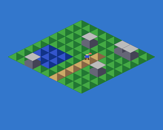

# Fragua

Una biblioteca para hacer juegos en [Dash](https://github.com/FreeMEM/dash) en el Amiga. Va en dos capas:

- **Capa 1, piezas sueltas, como pygame:** pantalla con doble búfer, imágenes, rectángulos, reloj, entrada, sprites
  y grupos.
- **Capa 2, nodos y escenas, como Godot:** un árbol de nodos con señales y grupos, física a paso fijo, cuerpos que
  chocan con el mapa de tiles, áreas, cámara, textos, sonido, partículas, tweens, isométrico, **comportamientos
  listos** (plataformas, patrulla, recogible, vida...) y **escenas** que el editor de Forja guardará y convertirá
  en Dash, con **eventos sin código**.

El diseño está en `docs/JUEGOS_DISENO.md` de [Forja](https://github.com/FreeMEM/forja); el plan y la bitácora de la
capa 2, en `docs/FRAGUA_LOOP.md`. La API está en inglés, como la de los builtins de Dash.

[English](README.en.md)

## Requisitos

Dash 2.17 o posterior (`./dash` o `./dash --gcc`). La máquina base es un A1200; en un A500 funciona con menos cosas
en pantalla.

## Capa 2 en un vistazo

```
import "fragua/fragua.dash"

struct Coin: Script
    value: Int = 10

    func ready(n: Node)
    end

    func process(n: Node, delta: Int)
    end

    func physics_process(n: Node)
    end

    func on_signal(n: Node, name: String, from: Node, data: Int)
        if name == "body_entered" and id_in_group(data, "player")
            game_add("score", self.value)
            n.queue_free()
        end
    end
end

Main
    level = new_node("Level")
    level.add_child(new_tilemap("Map", "level1.fmap"))      # del editor de mapas de Forja
    player = new_body2d("Player", 32, 160)
    player.add_child(new_sprite2d("Sprite", image_cached("player.iff"), 0, 0))
    player.add_to_group("player")
    player.add_behavior(Platformer())                       # corre y salta, sin más código
    level.add_child(player)
    coin = new_area2d("Coin", 120, 160)
    coin.add_child(new_sprite2d("Sprite", image_cached("coin.iff"), 0, 0))
    coin.script = Coin()
    level.add_child(coin)
    run(level)                                              # hasta quit()
end
```

- **Un solo struct `Node`** para todos los tipos: lo común (nombre, hijos, padre, posición, grupos, señales) y un
  campo por tipo (`n.body`, `n.sprite`, `n.area`, `n.map`, `n.camera`, `n.label`, `n.timer`...). Así
  `get_node("Jugador/Arma")` da un nodo con todo a mano.
- **Scripts:** un struct del juego con la interfaz `Script` (`ready`, `process`, `physics_process`, `on_signal`; los
  cuatro, aunque estén vacíos, y al menos un campo). `physics_process` va a 50 pasos por segundo fijos.
- **Señales:** `n.emit("hit", dato)`; las recibe el propio nodo y los conectados (`a.connect("hit", b)`), una vez
  por fotograma.
- **Tipos de nodo:** `Node`, `Node2D`, `Sprite2D`, `AnimatedSprite2D`, `HardwareSprite2D`, `CollisionShape2D` (caja
  o círculo), `Body2D` (`move_and_slide`, plataformas de un sentido, pendientes, rebote), `StaticBody2D`, `Area2D`,
  `TileMap`, `Camera2D` (por pantallazos), `Label`, `ColorRect`, `Timer`, `AudioPlayer`, `Particles2D`.
- **Comportamientos listos:** `Platformer`, `EightWay`, `Bullet`, `Follow`, `Patrol`, `BounceEdges`, `Wrap`,
  `DestroyOffscreen`, `Health`, `Damage`, `Pickup`, `Draggable`, `Blink`.
- **Escenas:** un `.escena` (JSON) con nodos, propiedades, scripts, comportamientos, escenas dentro de escenas y
  eventos con acciones; `tools/escena.py` lo convierte en un `.dash` legible (`scene_enemy()` da un árbol nuevo
  cada vez). Formato: `docs/ESCENAS.md`.
- **Isométrico:** `set_isometric(true)`: suelo en rombos, orden por profundidad, choques en el plano.
- **Referencia entera** (funciones, nodos, propiedades con tipo, valor por defecto y rango, señales,
  comportamientos y acciones): `docs/REFERENCIA.md`, sacada de `api/fragua.json`, que es también lo que usará el
  editor de escenas de Forja para su inspector, su ayuda y su autocompletado.

## Capa 1

```
import "fragua/fragua.dash"

Main
    s = open_screen(320, 256, 5, "Mi juego")
    s.background(0)
    nave = new_sprite(load_image("nave.iff"), 160, 200)
    clock = new_clock(50)
    while not key(KEY_ESC)
        n = clock.tick()
        s.begin()
        nave.erase()
        nave.rect.x = nave.rect.x + axis_x(1) * 2 * n
        nave.draw()
        s.present()
    end
    s.close()
end
```

- **Pantalla** (`open_screen`): pantalla propia con doble búfer, un fondo y rectángulos sucios (`s.mark`,
  `s.begin`): solo se repone el fondo donde se pintó algo.
- **Imagen** (`load_image`, `new_image`): un IFF del editor de sprites de Forja, con sus fotogramas.
- **Rect, reloj** (`new_clock`), **entrada** (`key`, `axis_x`, `fire`), **Sprite y Group** (`new_sprite`,
  `new_group`).

Desde la versión con nodos, `screen_open`, `image_load`, `image_new`, `sprite_new`, `group_new` y `clock_new` se
llaman `open_screen`, `load_image`, `new_image`, `new_sprite`, `new_group` y `new_clock`: Dash tiene ahora builtins
`screen_open` e `image_load`.

## Lo que cuesta

Medido en FS-UAE a velocidad real, un A1200 sin memoria Fast (68020 a 14 MHz), con `./dash --gcc`:

| | A1200 |
|---|---|
| Imagen de 16x16 con máscara (`bob_paste`) | 1,6 ms |
| Un paso de física con jugador, 2 o 3 enemigos y monedas cerca | 7-8 ms |
| Pong con nodos (3 sprites) | 13 ms por fotograma |
| Plataformas (unos 10 sprites en pantalla, a 25 por segundo) | 39-46 ms por fotograma |

Un fotograma son 20 ms. **En un A1200 caben unos 10 sprites (BOB) por fotograma a 50 Hz**: lo caro es pintar con
máscara, que lo hace el sistema con varias pasadas del blitter por plano. Para más, `set_frame_rate(25)` (la física
sigue a 50), sprites de hardware (`new_hw_sprite2d`, no cuestan nada) y niveles con menos cosas por pantalla. Los
nodos lejos de la cámara no trabajan. Con `./dash` (el compilador directo) la lógica va de 2 a 20 veces más lenta
que con `./dash --gcc`: los juegos, mejor con `--gcc` por ahora. Detalle y lo que falta en Dash: `docs/FRAGUA_LOOP.md`.

## Ejemplos y pruebas

- `examples/plataformas/`: plataformas hecho con escenas (`*.escena` y el `.dash` que generan): jugador, enemigos
  que se pisan, monedas con eventos sin código, cámara y marcador.

  

- `examples/pong_nodos/`: el Pong con nodos; `examples/pong/`: el mismo con la capa 1.
- `examples/iso/`: una sala isométrica con bloques que tapan y se dejan tapar.

  

- `tools/recursos.py` hace las imágenes, mapas y sonidos de los ejemplos.
- `tests/todas.sh DASH_DIR`: en FS-UAE, por los dos caminos de Dash, `Rect`, el árbol de nodos, las escenas y los
  ejemplos en modo demo (juegan solos). `A500=1` también en un A500. `tests/juego.sh` corre un ejemplo
  (`REAL=1`: a velocidad real; `GCC=1`; `PERFIL=1`: perfil de Dash; capturas).

## Pendiente

Ver `docs/FRAGUA_LOOP.md`: scroll suave (falta el scroll de hardware en Dash), pintar con máscara programando el
blitter, animaciones con pistas (AnimationPlayer), luces, guardar partida, plantilla de juego y el editor de escenas
de Forja.
