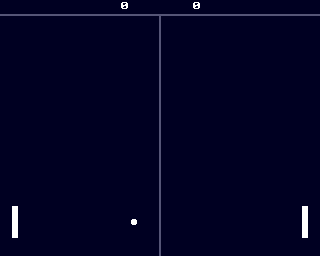

# Fragua

Una biblioteca para hacer juegos en [Dash](https://github.com/FreeMEM/dash) en el Amiga. Va en dos capas: piezas
sueltas, como pygame, y un árbol de nodos y escenas, como Godot. El diseño está en `docs/JUEGOS_DISENO.md` de
[Forja](https://github.com/FreeMEM/forja). La API está en inglés, como la de los builtins de Dash.

Estado: **fase 1**, la capa de piezas sueltas, con un Pong de ejemplo. La capa de nodos viene después.

[English](README.en.md)

## Requisitos

Un Dash con `key_down`, `bob_paste` y `bob_width`, `bob_height` y `bob_frames`. La máquina base es un A1200; en un
A500 funciona con menos cosas en pantalla.

## Uso

```
import "fragua/fragua.dash"

Main
    s = screen_open(320, 256, 5, "Mi juego")
    s.background(0)
    nave = sprite_new(image_load("nave.iff"), 160, 200)
    clock = clock_new(50)
    while not key(KEY_ESC)
        n = clock.tick()
        s.begin()
        nave.erase()
        nave.rect.x = nave.rect.x + axis_x(1) * 2 * n
        nave.draw()
        s.present()
    end
    s.close()
end
```

- **Pantalla** (`screen_open`): pantalla propia con doble búfer. `color`, `palette` (los colores de un IFF), `rect`,
  `text`, `present` (enseña lo pintado en el siguiente barrido).
- **Fondo:** borrar la pantalla entera cuesta más de un fotograma, así que la pantalla guarda un fondo
  (`background`, o `background_start` ... `background_end` para pintar en él). Cada fotograma empieza con
  `s.begin()` y `erase()` de los sprites, que reponen el fondo solo donde estaban.
- **Imagen** (`image_load`, `image_new`): un IFF del editor de sprites de Forja, con sus fotogramas, que se pinta con
  máscara (el color 0, transparente).
- **Rect:** choques, intersección, unión, `clamp`.
- **Reloj** (`clock_new(50)`): `tick()` dice cuántos fotogramas pasaron (más de 1 si el juego se retrasó).
- **Entrada:** `key(KEY_ESC)` (tecla pulsada ahora), `axis_x(1)`, `axis_y(1)` y `fire(1)` (joystick o flechas y
  espacio).
- **Sprite y Group:** imagen, rectángulo, fotograma y velocidad; el grupo mueve, pinta, borra y busca choques.

## Lo que cuesta

Medido en FS-UAE a velocidad real (`bench/costes.sh`), pantalla de 320x256 con 5 planos:

| | A1200 | A500 |
|---|---|---|
| Borrar la pantalla entera | 36,7 ms | 37,4 ms |
| Imagen de 16x16 con máscara | 1,6 ms | 3,3 ms |
| Imagen de 32x32 con máscara | 3,5 ms | 5,4 ms |
| Rectángulo de 32x32 | 0,9 ms | 1,2 ms |
| Texto de 13 letras | 2 ms | 4,6 ms |
| `key_down` | 0,08 ms | 0,28 ms |
| `Rect.collides` | 0,02 ms | 0,13 ms |

Un fotograma son 20 ms. El Pong de ejemplo gasta 5 ms por fotograma en un A1200 (pierde 2 de 500, los de pintar el
fondo al empezar) y 15 ms en un A500 (pierde 90 de 500).

## Ejemplos y pruebas

- `examples/pong/pong.dash`: W y S, o el joystick; la pala de la derecha juega sola. Esc sale.

  

- `tests/todas.sh DASH_DIR`: la prueba de `Rect` y el Pong en modo demo (`ENV:FRAGUA_DEMO`: juega solo 500
  fotogramas), en FS-UAE con `DASH_KICKSTART` (3.1). `REAL=1 tests/pong.sh ...` a la velocidad de un A1200;
  `A500=1`, de un A500.

## Pendiente

- Pintar con máscara más rápido: el pegado con máscara del sistema (`BltMaskBitMapRastPort`) hace varias pasadas
  del blitter por plano. Programar el blitter directamente (con `OwnBlitter`) lo haría en una.
- `key_down` no se ha probado con una tecla de verdad: el emulador de las pruebas solo simula teclas por
  `input.device`, que no llega a la matriz del teclado.
- Fase 2: mapas de tiles (del editor de mapas de Forja) y cámara con scroll por hardware.
